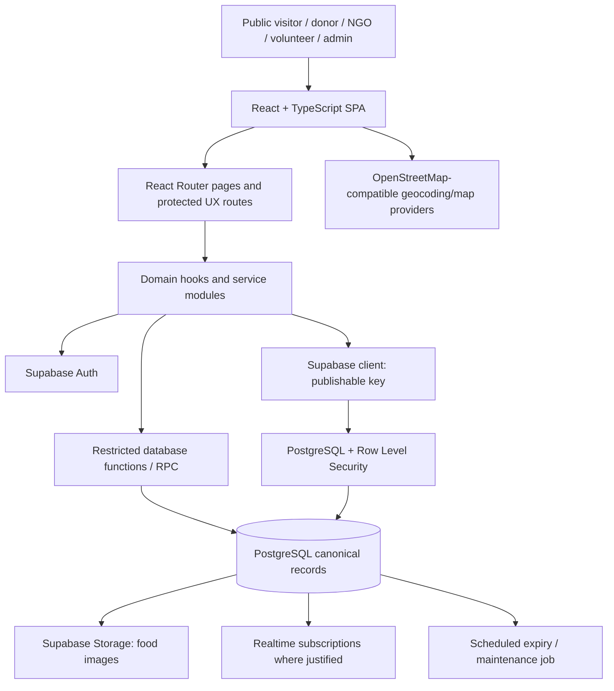
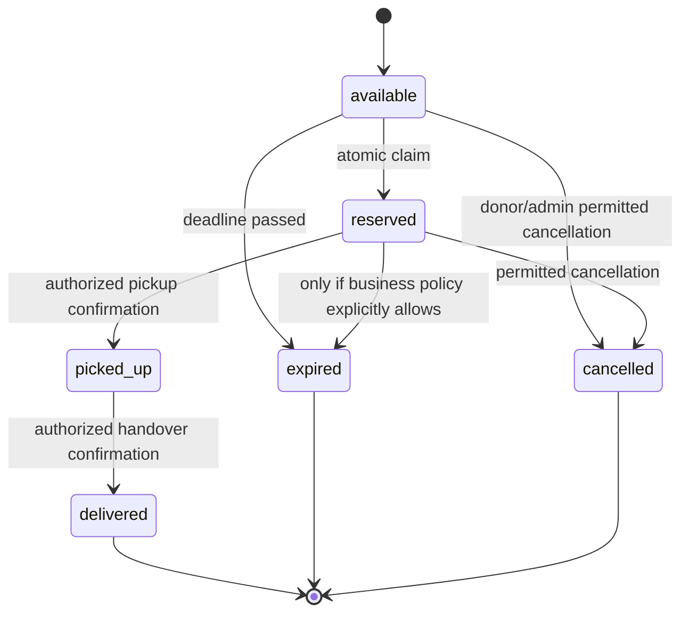

# RescuePlate — Architecture Document

## 1. Purpose and scope

This document describes the recommended implementation architecture for the supplied RescuePlate prototype and its target functional application. It is written for a coding agent and engineers who will extend the existing repository rather than rebuild blindly.

## 2. Current prototype baseline

The supplied ZIP contains a Vite React application using TypeScript, Tailwind CSS, React Router, Supabase JS, Leaflet, Recharts, Lucide icons, and Sonner. It includes routes/pages for Home, Login, Register, Marketplace, Impact, and donor/NGO/volunteer/admin dashboards. It also includes `supabase/schema.sql`, `seed_demo.sql`, and `make_admin.sql`.

The README describes a browser-based Supabase setup screen. Browser code uses a Supabase publishable/anon key, with RLS intended to enforce access. Public donation location is approximate, and private address data is separated. Claiming is intended to be atomic. Pickup codes are intended to be random, short-lived, single-use, and stored as hashes.

Known prototype limitations documented in the README:
- Email/SMS/WhatsApp notifications are not implemented; only in-app notifications exist.
- Camera QR scanning is not implemented; users type/paste the pickup code.
- Automated tests are not yet implemented.

These are explicit gaps, not completed features. Verify current code and SQL behavior before claiming any security property as proven.

## 3. Architectural goals

- Keep UI, domain workflows, and persistence concerns separated.
- Use Supabase Auth for identity, PostgreSQL for canonical state, RLS for data authorization, and restricted database functions for sensitive transitions.
- Make claims and workflow transitions atomic and auditable.
- Keep private pickup data separate from public marketplace data.
- Make demo data explicit and prevent it from silently contaminating production metrics.
- Keep the application deployable with configuration documented and secrets outside the client bundle.

## 4. High-level architecture



The browser must never contain the Supabase service-role key. Sensitive operations should use database functions with carefully restricted execution rights or a trusted server/edge function. Do not put authorization-critical logic solely in React.

## 5. Technology decisions

- **Frontend:** React 18 + TypeScript + Vite.
- **Routing:** React Router; protected routes improve UX but are not an authorization boundary.
- **Styling:** Tailwind CSS with design tokens and reusable accessible components. Existing prototype uses Tailwind and custom components; shadcn/ui may be introduced selectively rather than replacing working components without reason.
- **Backend platform:** Supabase Auth, PostgreSQL, Storage, optional Realtime.
- **Database security:** RLS policies, constraints, indexes, restricted SQL functions.
- **Maps/geocoding:** Leaflet and OpenStreetMap-compatible public services in current prototype. Add timeouts, rate-limit-aware retries, caching where appropriate, and a non-map fallback.
- **Charts:** Recharts for impact trends.
- **Notifications:** Existing in-app table and UI; external providers behind future adapter interfaces.
- **Language:** Existing i18n context and English/Hindi translation module.

## 6. Suggested repository layout

Preserve the supplied repository unless there is a clear reason to restructure. A target structure may evolve toward:

```text
rescueplate/
├── public/
├── src/
│   ├── app/                 # route composition and app providers
│   ├── components/          # shared presentational components
│   ├── features/
│   │   ├── auth/
│   │   ├── donations/
│   │   ├── marketplace/
│   │   ├── pickups/
│   │   ├── organizations/
│   │   ├── notifications/
│   │   ├── reports/
│   │   └── impact/
│   ├── pages/               # route-level page composition
│   ├── contexts/            # auth, theme, i18n
│   ├── hooks/               # reusable client hooks
│   ├── lib/                 # supabase client, utilities, i18n
│   ├── services/            # typed persistence/domain adapters
│   ├── types/               # shared domain types
│   └── test/                # test setup and fixtures
├── supabase/
│   ├── migrations/          # ordered SQL migrations
│   ├── functions/           # trusted edge functions if needed
│   ├── tests/               # SQL/RLS tests where supported
│   ├── seed_demo.sql
│   └── README.md
├── docs/
│   ├── PRD.md
│   ├── DESIGN.md
│   ├── ARCHITECTURE.md
│   └── SECURITY.md
├── .env.example
├── package.json
└── README.md
```

This is a target organization, not a requirement to move every file in one pass. Avoid large refactors that delay critical workflow and security fixes.

## 7. Domain model

### 7.1 Entities

- **Profile:** identity-linked user profile; role, name, optional phone, language, suspension state, optional organization link.
- **Organization:** donor/NGO identity, owner, type, city, verification status, evidence metadata, demo marker.
- **Donation:** public listing details, quantity, category/diet, preparation time, availability window, approximate location, image reference, donor, status, demo marker.
- **DonationPrivate:** exact pickup address and sensitive pickup instructions. Access is limited to donor, authorized NGO/collector, and authorized admin as policy allows.
- **Pickup:** claim and logistics record connecting a donation to an NGO and optional assigned volunteer; lifecycle timestamps and distribution report fields.
- **PickupToken:** hash of one-time verification token, expiry, consumption timestamp, and related pickup.
- **Notification:** recipient, type, safe structured payload, read status, timestamp.
- **Report:** safety/abuse/operations report, reporter, related record, state, resolution.
- **Audit event (recommended):** append-only record for sensitive decisions and transitions.

### 7.2 State machines

Donation lifecycle:



The database must enforce valid transitions. Product policy must explicitly decide cancellation/expiry rules after reservation; never infer them from client behavior. Once picked up, do not automatically mark food expired or return it to the public pool.

Pickup lifecycle can mirror reserved → picked_up → delivered, with cancellation only where allowed. Donation and pickup status must be updated consistently in one transaction/function.

## 8. Data access patterns

- Use typed service functions for common operations: `listAvailableDonations`, `createDonation`, `updateOwnDonation`, `claimDonation`, `assignVolunteer`, `confirmPickup`, `recordDelivery`, `reportIssue`, `markNotificationRead`, and `reviewOrganization`.
- Do not allow arbitrary clients to update status columns directly. Use RPC/edge functions for claim, status transition, verification, suspension, and token consumption.
- Keep query construction and mapping out of presentational components.
- Paginate lists and avoid loading entire tables for dashboard metrics.
- Filter claimable donations on both query and server/database eligibility checks. UI filters are not security controls.
- Prefer database views or carefully scoped aggregate functions for impact statistics, with demo inclusion explicitly controlled.

## 9. Critical operations

### 9.1 Atomic claim

A trusted database function should:
1. Identify the authenticated actor from server-provided auth context.
2. Check profile is active and role/organization verification qualifies.
3. Lock or atomically update the donation only if status is `available` and deadline is still in the future.
4. Create exactly one pickup record and bind it to the authorized NGO.
5. Update donation to `reserved`.
6. Create in-app notifications/audit event.
7. Commit all changes together; return a clear conflict if another claimant won.

Use a unique constraint or equivalent invariant so the database itself prevents multiple active claims for a donation.

### 9.2 Pickup token

- Generate high-entropy random token in a trusted context.
- Store only a cryptographic hash; do not log raw token.
- Bind token to one pickup and intended workflow/action.
- Expire quickly (prototype target 15 minutes), consume atomically once, and record actor/timestamp.
- Rate-limit failed attempts and return generic errors that do not disclose other pickup details.
- Authenticated user and role/assignment checks are required independently of possession of the token.

### 9.3 Expiry

- Enforce `pickup_deadline > now()` at claim time even if a scheduled job has not run.
- Scheduled maintenance marks eligible available records expired and creates notifications idempotently.
- Make the job safe to rerun and index deadline/status fields.

### 9.4 Impact aggregation

- Use completed pickup records for collected amounts and explicit distribution records for meals distributed.
- Define how corrections/voided pickups affect aggregates.
- Exclude demo data by default or expose an explicit `includes_demo` indicator.
- Avoid counting one pickup multiple times from joins; aggregate from canonical entities or deduplicated subqueries.

## 10. Authentication and authorization

- Supabase Auth owns authentication/session lifecycle.
- `profiles.id` references the authenticated user ID.
- Public role selection is constrained to allowed roles; `admin` can only be assigned through a trusted administrative path.
- RLS is enabled on all app tables and storage objects where applicable.
- Public users may read only public-safe donation fields and verified public organization details.
- Donors can read/update only their own permitted records.
- Verified NGOs can access claimable data and their own pickup records.
- Volunteers can access pickup records and private details only when assigned/authorized.
- Admin reads/writes are explicitly checked server-side and audited.

## 11. External services and failure behavior

- **Supabase:** show a setup/configuration state if credentials or schema are missing; never silently fall back to fake success.
- **OpenStreetMap/Overpass/Nominatim:** handle unavailable/rate-limited services with retry affordance; map is non-critical to listing and claim workflows.
- **Storage:** validate file size/type, handle upload failure, and avoid storing secrets in image metadata or paths.
- **External notifications:** adapter interface may be added, but mark channels unavailable until credentials and provider behavior are verified.

## 12. Environment and configuration

Provide `.env.example` with only public client configuration, such as:

```dotenv
VITE_SUPABASE_URL=https://YOUR_PROJECT.supabase.co
VITE_SUPABASE_ANON_KEY=YOUR_PUBLISHABLE_OR_ANON_KEY
```

Do not commit real credentials. A service-role key, database password, webhook signing secret, or provider secret must never use a `VITE_` prefix or be bundled into client assets. If the prototype keeps a setup screen that accepts credentials in-browser, document the trade-offs and ensure only the publishable key is accepted; production deployments should prefer deployment-time environment configuration.

## 13. Testing strategy

- **Unit:** validators, status transition rules, deadline helpers, i18n formatters, impact aggregation helpers.
- **Component:** form errors, loading/empty/error states, route-level rendering, accessible interactions.
- **Integration:** Supabase auth/profile setup, donation CRUD, RLS policy behavior, private-address isolation.
- **Concurrency:** two simultaneous claims result in exactly one successful reservation.
- **Security:** non-admin cannot grant admin; unverified NGO cannot claim; unrelated volunteer cannot access private pickup; expired token/reused token rejected; suspended account blocked.
- **E2E:** donor publishes → verified NGO claims → authorized collector confirms pickup → delivery/distribution is recorded → impact updates.
- **Build:** TypeScript check and production Vite build in CI.

Use isolated test projects/fixtures and never run destructive security tests against production data.

## 14. Deployment and operations

1. Create Supabase project and apply ordered migrations.
2. Review RLS, grants, database functions, storage policies, and admin provisioning before seeding.
3. Configure frontend public environment variables in hosting provider.
4. Configure allowed redirect URLs and authentication settings.
5. Configure scheduled expiry function/job if used.
6. Build and deploy static frontend; configure SPA fallback to `index.html` for deep links.
7. Run smoke tests for auth, listing, claim conflict, private address, pickup completion, and impact.
8. Configure backups, error monitoring, log retention, and incident contact process.
9. Keep seed/demo data isolated or explicitly marked and excluded from production metrics by default.

## 15. Architecture decision records (initial)

- **ADR-001: Supabase as managed backend.** Selected for Auth, PostgreSQL, Storage, RLS, and optional Realtime, reducing custom infrastructure for the MVP.
- **ADR-002: Database is the authority for workflow transitions.** Prevents clients from bypassing status rules and resolves claim races.
- **ADR-003: Separate public and private donation data.** Reduces accidental exposure of exact addresses and pickup instructions.
- **ADR-004: Maps are optional enhancement.** Location provider failures must not break core workflows.
- **ADR-005: Explicit demo-data labeling.** Prevents misleading impact claims and makes prototype behavior honest.

## 16. Open technical decisions

- Whether any sensitive workflow should move from PostgreSQL RPC to Supabase Edge Functions.
- Production admin provisioning, key custody, and break-glass access.
- Scheduled-job provider and monitoring.
- Formal schema migration/test framework and CI provider.
- Data retention and account deletion semantics.
- Volunteer eligibility and whether assignment must be mediated by an NGO.

## 17. Implementation status (21 October 2026)

### Database

- `supabase/migrations/0001_init.sql` — baseline schema, RLS, workflow functions.
- `supabase/migrations/0002_hardening.sql` — audit trail, token throttling, suspension
  re-checks, expiry notifications, report categories, audited admin report resolution,
  storage allowlist. Idempotent and safe to re-run on top of 0001.
- `supabase/migrations/0003_storage_repair.sql` — idempotent repair for installs whose
  `schema.sql` paste was cut off before the storage tail: creates the `food-images` bucket,
  recreates the storage policies, ensures `notifications` is in the realtime publication
  and schedules `expire_donations()` when pg_cron is enabled.
- `supabase/schema.sql` — rolled-up equivalent for paste-based installs; kept in sync with
  all three migrations (documented at the top of the file).
- `scripts/check-supabase.mjs` (`npm run db:check`) — read-only live drift check (tables,
  functions, anon leak probes, storage, realtime) using only the publishable key.
- New table `audit_events` (append-only; admin read policy only) and
  `pickup_token_attempts` (no policies at all).
- `reports.category` added; direct report updates removed from RLS in favour of
  `admin_set_report_status(uuid, text, text)`.
- All privileged functions still validate `auth.uid()`, role, suspension and state; grants
  were re-issued so anon/public cannot execute workflow or admin functions. `expire_donations()`
  and `audit()` are intentionally ungranted.

### Frontend

- New `/reset` password-recovery page and “Forgot password?” on login.
- Donor form supports editing available listings; protected workflow fields are never sent and
  are rejected by the DB guard trigger.
- Marketplace pages results (24 at a time) and includes report categories.
- Admin report resolution calls the audited RPC instead of a direct table update.
- Homepage partner cards label demo organizations.

### Tests

- `src/**/*.test.ts(x)` run with Vitest + Testing Library + jsdom (`npm test`): time/distance
  logic, error mapping, i18n key parity, input validation, registration role surface,
  ProtectedRoute behaviour, public card privacy, and SQL syntax + security invariants
  (parsed with libpg_query; no database required).
- `supabase/tests/workflow_and_rls.test.sql` — self-asserting RLS/workflow/token/impact suite,
  run with `npm run test:db` against a local Supabase database.
- `scripts/claim-race-test.mjs` — two-connection concurrent claim test (`npm run test:race`).
- These database suites require a Supabase runtime and were not executed in the current
  environment; see `supabase/tests/README.md`.

### Operational follow-ups

- Schedule `expire_donations()` with `pg_cron` per project (comment in `schema.sql`).
- Configure auth email confirmation, site URL and `/reset` redirect per environment.
- Add CI to run `npm test`, `npm run build`, and (against a disposable Supabase project) the
  database suites.
- External notification adapters, camera scanning and image re-encoding remain future work.
